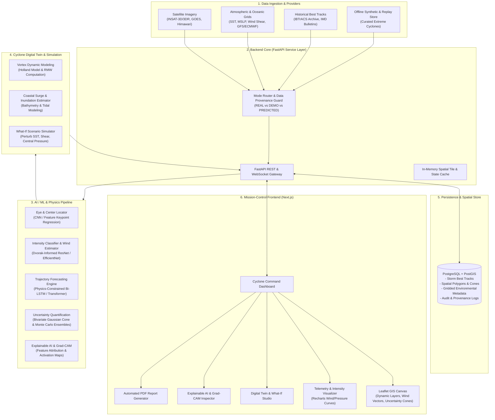
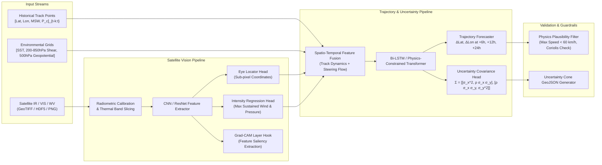
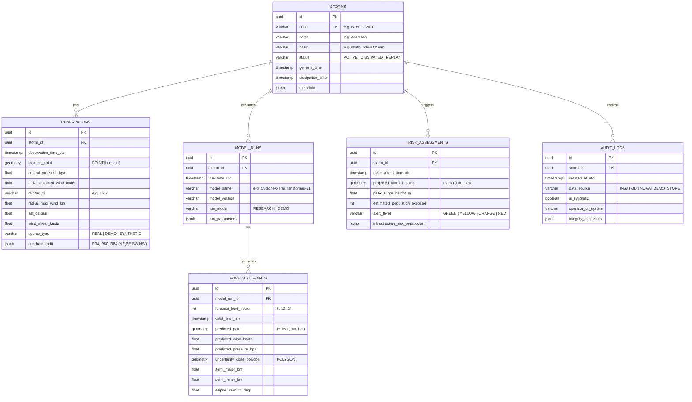

# CYCLONE-X: System Architecture & Technical Specification

**AI-Powered Tropical Cyclone Intelligence, Digital Twin, and Disaster Decision-Support Platform**

---

## 1. Executive System Overview

CYCLONE-X is a mission-critical meteorological intelligence and disaster response platform designed to bridge cutting-edge deep learning with operational atmospheric physics. Unlike standard cyclone dashboards that merely display historical tracks or delayed public bulletins, CYCLONE-X implements an end-to-end operational pipeline:

$$\text{OBSERVE} \longrightarrow \text{DETECT} \longrightarrow \text{CLASSIFY} \longrightarrow \text{LOCATE} \longrightarrow \text{TRACK} \longrightarrow \text{PREDICT (6h/12h/24h)} \longrightarrow \text{UNCERTAINTY} \longrightarrow \text{RISK ASSESSMENT} \longrightarrow \text{SIMULATE} \longrightarrow \text{EXPLAIN (XAI)} \longrightarrow \text{REPORT}$$

### Core Tenets
1. **Physical Consistency & Scientific Integrity**: Machine learning predictions are anchored by physical cyclone dynamics (Holland / Modified Rankine vortex equations, steering flow vectors, Sea Surface Temperature thresholds).
2. **Absolute Data Provenance**: Every observation, raster layer, and model inference is strictly partitioned into `REAL_OBSERVATION`, `DEMO_PLAYBACK`, or `AI_PREDICTION`, accompanied by UTC timestamps and sensor metadata.
3. **Decoupled Mission-Control UX**: A modular Next.js dashboard providing interactive geospatial mapping, temporal scrubbing, digital twin simulation, and explainability visuals.
4. **Actionable Disaster Intelligence**: Translates raw meteorological vectors (knots, hPa, coordinates) into humanitarian risk profiles (surge height, population at risk, infrastructure vulnerability, automated briefing PDFs).

---

## 2. High-Level System Architecture



---

## 3. Production-Style Repository Directory Layout

```
cyclone-x/
├── .env.example
├── .gitignore
├── README.md
├── ARCHITECTURE.md
├── PROJECT_PLAN.md
│
├── backend/
│   ├── Dockerfile
│   ├── pyproject.toml
│   ├── requirements.txt
│   ├── app/
│   │   ├── __init__.py
│   │   ├── main.py                     # FastAPI entrypoint, middleware, CORS
│   │   ├── config.py                   # Pydantic BaseSettings, app configuration
│   │   │
│   │   ├── api/                        # API routes
│   │   │   ├── __init__.py
│   │   │   ├── router.py               # Aggregated v1 API router
│   │   │   ├── v1/
│   │   │   │   ├── __init__.py
│   │   │   │   ├── cyclones.py         # Active & historical storm queries
│   │   │   │   ├── detection.py        # Trigger satellite CV detection & eye locator
│   │   │   │   ├── forecast.py         # 6h, 12h, 24h trajectory & uncertainty cones
│   │   │   │   ├── environmental.py    # SST, wind shear, isobaric pressure layers
│   │   │   │   ├── digital_twin.py     # Holland wind field & surge modeling
│   │   │   │   ├── simulation.py       # What-if perturbation experiments
│   │   │   │   ├── xai.py              # Grad-CAM maps, feature saliency
│   │   │   │   ├── reports.py          # PDF generation & intelligence briefings
│   │   │   │   └── system.py           # Health checks, data mode status
│   │   │
│   │   ├── core/                       # Core infrastructure & guards
│   │   │   ├── __init__.py
│   │   │   ├── security.py             # API keys / rate limiting
│   │   │   ├── provenance.py           # Verification for Real vs Demo vs AI data
│   │   │   ├── exceptions.py           # Unified exception definitions
│   │   │   └── logging.py              # Structured JSON logging
│   │   │
│   │   ├── schemas/                    # Pydantic schemas (Contracts)
│   │   │   ├── __init__.py
│   │   │   ├── cyclone.py              # Storm metadata, observation, track point
│   │   │   ├── detection.py            # Center location, bounding box, eye confidence
│   │   │   ├── forecast.py             # Trajectory point, cone coordinates, uncertainty
│   │   │   ├── environmental.py        # SST grid, wind vector field, pressure isolines
│   │   │   ├── digital_twin.py         # Vortex radii (RMW, R34, R50, R64), surge profile
│   │   │   ├── simulation.py           # What-if input params and perturbed output
│   │   │   ├── xai.py                  # Heatmap matrices, feature attribution lists
│   │   │   └── report.py               # Report request/response metadata
│   │   │
│   │   ├── services/                   # Business & domain logic
│   │   │   ├── __init__.py
│   │   │   ├── cyclone_service.py      # Tracking and timeline orchestration
│   │   │   ├── detection_service.py    # Inference coordinator for vision models
│   │   │   ├── forecast_service.py     # Trajectory pipeline & uncertainty engine
│   │   │   ├── environmental_service.py# Environmental ingestion & spatial resampling
│   │   │   ├── digital_twin_service.py # Physics vortex & hydrodynamic surge logic
│   │   │   ├── simulation_service.py   # Scenario simulator engine
│   │   │   ├── xai_service.py          # Grad-CAM rendering & explanation synthesis
│   │   │   ├── report_service.py       # Automated PDF report builder (ReportLab/HTML)
│   │   │   └── data_provider_service.py# Adapter between live APIs and offline benchmarks
│   │   │
│   │   └── db/                         # Database connection & models
│   │       ├── __init__.py
│   │       ├── session.py              # SQLAlchemy async engine & sessionmaker
│   │       ├── base.py                 # Declarative base
│   │       └── models/
│   │           ├── __init__.py
│   │           ├── storm.py            # Storm definitions & metadata
│   │           ├── observation.py      # Spatial observation points (PostGIS)
│   │           ├── forecast.py         # Forecast runs, predicted tracks & cones
│   │           ├── risk.py             # Disaster vulnerability & impact records
│   │           └── audit.py            # Data source audit & provenance log
│   │
│   └── tests/                          # Backend test suite
│       ├── conftest.py
│       ├── test_api_cyclones.py
│       ├── test_physics_vortex.py
│       ├── test_forecast_uncertainty.py
│       └── test_provenance_guard.py
│
├── ml/                                 # AI/ML & Scientific Pipeline
│   ├── pyproject.toml
│   ├── configs/
│   │   ├── detection_config.yaml
│   │   ├── intensity_config.yaml
│   │   └── trajectory_config.yaml
│   │
│   ├── vision/                         # Satellite Computer Vision
│   │   ├── __init__.py
│   │   ├── preprocessor.py             # GeoTIFF/PNG radiometry, IR enhancement
│   │   ├── eye_locator.py              # Center detection (Hough + CNN keypoint)
│   │   ├── intensity_classifier.py     # Dvorak-guided CNN / ResNet model
│   │   └── gradcam.py                  # PyTorch hook-based Grad-CAM generator
│   │
│   ├── trajectory/                     # Trajectory & Spatio-Temporal Forecasting
│   │   ├── __init__.py
│   │   ├── model.py                    # Trajectory Bi-LSTM / Physics-Informed Transformer
│   │   ├── steering_flow.py            # 500 hPa environmental steering integration
│   │   ├── uncertainty.py              # Bivariate Gaussian covariance & error cone generator
│   │   └── evaluator.py                # Track forecast error (km) & Intensity MAE/RMSE
│   │
│   ├── physics/                        # Mathematical Cyclone Models
│   │   ├── __init__.py
│   │   ├── holland_vortex.py           # Holland (1980) Wind-Pressure Profile
│   │   ├── rankine_vortex.py           # Modified Combined Rankine Vortex
│   │   ├── radius_max_wind.py          # Empirical RMW estimator (Knaff & Zehr)
│   │   └── storm_surge.py              # Bathymetry wind stress surge depth estimator
│   │
│   ├── weights/                        # Model artifacts (download script / placeholders)
│   │   └── README.md
│   │
│   └── notebooks/                      # Exploratory data analysis & validation
│       ├── 01_satellite_feature_extraction.ipynb
│       └── 02_trajectory_uncertainty_validation.ipynb
│
├── data/                               # Data Directory
│   ├── raw/                            # Raw downloaded frames (gitignored)
│   ├── processed/                      # Normalized GeoJSON & NetCDF clips
│   ├── sample_satellite/               # Curated IR/Visible bands (Amphan, Fani, Biparjoy)
│   ├── demo_scenarios/                 # Offline fallback JSON benchmarks
│   │   ├── cyclone_amphan_2020.json
│   │   ├── cyclone_fani_2019.json
│   │   └── cyclone_biparjoy_2023.json
│   └── bathymetry/                     # Coastal elevation & bathymetry lookup grid
│
├── frontend/                           # Next.js Frontend Application
│   ├── package.json
│   ├── tsconfig.json
│   ├── tailwind.config.js
│   ├── postcss.config.js
│   ├── next.config.js
│   ├── public/
│   │   ├── sample_ir/                  # High-res satellite imagery samples
│   │   ├── icons/
│   │   └── markers/                    # Custom SVG hurricane category icons
│   │
│   └── src/
│       ├── app/                        # App router
│       │   ├── layout.tsx              # Root layout & header telemetry banner
│       │   ├── page.tsx                # Main Mission Control page
│       │   ├── simulator/
│       │   │   └── page.tsx            # Digital Twin What-If Scenario Studio
│       │   ├── explainability/
│       │   │   └── page.tsx            # Grad-CAM & XAI Inspector
│       │   ├── replay/
│       │   │   └── page.tsx            # Historical Storm Replay & Model Validation
│       │   └── reports/
│       │       └── page.tsx            # Automated PDF Briefing Generator
│       │
│       ├── components/                 # Reusable UI components
│       │   ├── common/
│       │   │   ├── Header.tsx          # Navigation, status, mode badge
│       │   │   ├── ModeBadge.tsx       # REAL vs DEMO vs PREDICTED badge
│       │   │   ├── DisclaimerBanner.tsx# Mandatory scientific advisory notice
│       │   │   └── MetricCard.tsx      # High-density telemetry cards
│       │   │
│       │   ├── map/                    # GIS Interactive Map (Leaflet)
│       │   │   ├── CycloneMap.tsx      # Main map viewport & controls
│       │   │   ├── TrackLayer.tsx      # Historical observed track line + markers
│       │   │   ├── ForecastConeLayer.tsx# 6h/12h/24h Cone of Uncertainty polygon
│       │   │   ├── EnvironmentalLayer.tsx# SST heatmap, wind vector field overlay
│       │   │   ├── EyeMarker.tsx       # Animated vortex center pin
│       │   │   └── SurgeRiskLayer.tsx  # Inundation hazard zones along coastline
│       │   │
│       │   ├── telemetry/              # Sensor & Telemetry charts
│       │   │   ├── WindPressureChart.tsx# Recharts dual-axis wind & MSLP timeline
│       │   │   ├── ErrorAnalysisChart.tsx# Observed vs Predicted track deviation
│       │   │   └── RadialWindProfile.tsx# Holland vortex wind velocity vs radius
│       │   │
│       │   ├── xai/                    # Explainable AI components
│       │   │   ├── GradCamViewer.tsx   # Interactive alpha-blended heatmap overlay
│       │   │   └── FeatureImportance.tsx# Bar chart of steering and SST weights
│       │   │
│       │   ├── simulator/              # What-If Studio components
│       │   │   ├── ParameterSliders.tsx# SST, pressure, forward velocity controls
│       │   │   └── ImpactComparison.tsx# Baseline vs perturbed outcome diff
│       │   │
│       │   └── digital_twin/           # 2D/3D Digital Twin visualization
│       │       ├── VortexStructure.tsx # Tangential wind & spiral band animation
│       │       └── SectorHazardGrid.tsx# Quadrant breakdown (Right-Front quadrant risk)
│       │
│       ├── hooks/                      # Custom React hooks
│       │   ├── useCycloneData.ts       # Hook for fetching active/historical storm
│       │   ├── useForecast.ts          # Hook for trajectory predictions
│       │   └── useScenarioSim.ts       # Hook for interactive what-if queries
│       │
│       ├── lib/                        # Client utilities
│       │   ├── api.ts                  # Axios/Fetch client with error handling
│       │   ├── geo.ts                  # Geodesic math, haversine, bearing
│       │   ├── dvorak.ts               # Dvorak CI to knots/pressure conversion
│       │   └── constants.ts            # Hurricane categories (IMD / Saffir-Simpson)
│       │
│       └── types/                      # TypeScript declarations
│           ├── cyclone.ts              # Storm and observation types
│           ├── forecast.ts             # Trajectory, confidence ellipses
│           ├── environmental.ts        # SST, MSLP, Shear types
│           └── simulation.ts           # What-If parameters & results
│
├── infra/                              # Deployment & Containerization
│   ├── docker-compose.yml              # Local multi-container setup (PostGIS, FastAPI, Next.js)
│   └── postgis-init/
│       └── 01_init_postgis.sql         # PostGIS extensions, spatial tables & spatial indices
│
└── docs/                               # Developer & Scientific Documentation
    ├── SCIENTIFIC_INTEGRITY.md         # Data attribution, non-fabrication principles
    ├── API_SPEC.md                     # OpenAPI specification summary
    └── USER_GUIDE.md                   # Operational guide for disaster management teams
```

---

## 4. Frontend Architecture (Next.js, TypeScript, Tailwind, Leaflet, Recharts)

### 4.1 State Management & Data Flow Architecture
The frontend is constructed using **Next.js App Router** with a clear separation of concerns:
- **Server Components** for initial page scaffolding, static asset metadata, and SEO.
- **Client Components** (`"use client"`) for stateful controls: the dynamic Leaflet canvas, interactive time scrubber, real-time telemetry charting, and simulation sliders.
- **Unified Global Context (`CycloneContext`)**:
  - `selectedStormId`: Currently active or historical storm (e.g., `amphan-2020`).
  - `activeTimestampUtc`: Current operational scrub time.
  - `systemMode`: `REAL_TIME` | `DEMO_PLAYBACK` | `SIMULATION`.
  - `layerVisibility`: Map layer toggles (Observed Track, 6h/12h/24h Forecast Cone, SST Grid, Wind Shear, Cyclone Eye Marker, Surge Inundation).
  - `activeForecastRun`: Trajectory prediction payload including uncertainty bounds.

### 4.2 Interactive GIS Mapping Architecture (Leaflet)
Leaflet is integrated dynamically via dynamic imports (`ssr: false`) to avoid server-side `window` reference errors.
1. **Multi-Layer Geodesic Canvas**:
   - **Base Map**: High-contrast Dark Matter / CartoDB Dark basemap to optimize contrast for high-energy meteorological phenomena.
   - **Cyclone Center & Eye Marker**: Pulsing SVG marker highlighting current center coordinates, eye radius, and Dvorak intensity category.
   - **Track Polyline & Geodesic Segments**: Historical points colored dynamically by storm intensity category (Deep Depression, Cyclonic Storm, Severe Cyclonic Storm, Very Severe, Extremely Severe, Super Cyclone).
   - **Forecast Cone of Uncertainty (6h, 12h, 24h)**: Dynamic GeoJSON polygon computed on the backend from bivariate Gaussian covariance ellipses along the forecast path.
   - **Wind Vector & Streamline Layer**: Animated particle wind field representing low-level atmospheric flow.
   - **Sea Surface Temperature (SST) Thermal Gradient**: Raster heatmap overlay with an interactive color bar showing the crucial $26.5^\circ\text{C}$ tropical cyclone genesis threshold.

### 4.3 Digital Twin & Telemetry Panels (Recharts)
- **Wind & Pressure Dual-Axis Telemetry**: Synchronized line charts displaying Maximum Sustained Wind (knots) and Minimum Central Pressure (hPa) over time, with clear demarcation between historical observation and future AI prediction.
- **Quadrant Wind Radii Radar / Polar View**: Displays R34 (34-knot gale radius), R50 (50-knot storm radius), and R64 (64-knot hurricane radius) broken down across NE, SE, SW, and NW quadrants (vital for identifying the destructive Right-Front Quadrant).
- **Holland Vortex Radial Profile Chart**: Plot of tangential wind speed $V(r)$ versus distance from cyclone center $r$, visualizing the eye wall peak at Radius of Maximum Wind ($R_{max}$).

### 4.4 Explainable AI (XAI) & Grad-CAM Visualizer
- Visualizer modal allowing operators to view the original infrared/visible satellite channel, the Grad-CAM activation heatmap, and a side-by-side alpha-blended inspection view.
- Accompanied by a **Feature Attribution Bar** indicating the relative contribution of core physical factors:
  - Eye wall symmetry (CNN convolutional weights).
  - Sea Surface Temperature thermal flux.
  - 850–200 hPa Vertical Wind Shear magnitude.
  - Mid-tropospheric Relative Humidity.

---

## 5. Backend Architecture (FastAPI, Pydantic, Uvicorn)

### 5.1 Service Layer & Separation of Responsibilities
FastAPI is structured as a modular micro-monolith with asynchronous I/O and strict schema validation:
- **`app/main.py`**: Initializes FastAPI, configures CORS for local and production frontends, attaches structured logging, and registers the v1 API router.
- **`app/core/provenance.py`**: Interceptor and middleware that checks every response payload to ensure proper labeling:
  - Injects `data_provenance: { source: str, mode: "REAL" | "DEMO" | "PREDICTION", timestamp_utc: str, experimental_notice: str }`.
- **`app/services/forecast_service.py`**:
  - Pulls the last $N$ track observations.
  - Queries environmental steering vectors.
  - Invokes the AI Trajectory Inference pipeline.
  - Computes spatial uncertainty bounds and formats them into GeoJSON FeatureCollections for the frontend Leaflet engine.
- **`app/services/digital_twin_service.py`**:
  - Solves the Holland wind profile for any coordinate $(lat, lon)$.
  - Calculates the Radius of Maximum Wind ($R_{max}$) and central pressure deficit ($\Delta P = P_{env} - P_c$).
  - Evaluates simplified shallow-water bathymetric wind stress to compute coastal storm surge height (meters).
- **`app/services/report_service.py`**:
  - Compiles storm telemetry, predicted landfall coordinates, population-at-risk calculations, and emergency recommendations into a multi-page, formatted PDF intelligence briefing.

### 5.2 API Contract Design (REST Endpoints)

| Method | Endpoint | Description |
| :--- | :--- | :--- |
| `GET` | `/api/v1/system/health` | System status, database connection, model load states |
| `GET` | `/api/v1/system/mode` | Current mode (`DEMO` vs `REAL_RESEARCH`), active sources |
| `GET` | `/api/v1/cyclones/active` | List of active tropical cyclones globally or in target basin |
| `GET` | `/api/v1/cyclones/{storm_id}` | Complete storm metadata, historical track, and current state |
| `POST`| `/api/v1/detection/analyze-image` | Upload/specify satellite image; returns eye center, bbox, intensity |
| `GET` | `/api/v1/forecast/{storm_id}` | 6h, 12h, 24h trajectory predictions + uncertainty cone GeoJSON |
| `GET` | `/api/v1/environmental/layers` | SST raster metadata, wind shear vectors, isobaric contours |
| `GET` | `/api/v1/digital-twin/{storm_id}`| Full vortex structure, quadrant wind radii (R34/R50/R64), surge profile |
| `POST`| `/api/v1/simulation/what-if` | Run perturbation scenario (alter SST, pressure, translation speed) |
| `GET` | `/api/v1/xai/gradcam/{storm_id}`| Grad-CAM heatmap tensor and spatial coordinates for eye/rainbands |
| `POST`| `/api/v1/reports/generate` | Generates official PDF intelligence briefing |

---

## 6. AI/ML Pipeline Architecture



### 6.1 Satellite Computer Vision (Eye Locator & Intensity Classifier)
- **Band Inputs**: Thermal Infrared Band (10.8 $\mu\text{m}$ brightness temperature for deep convection cloud tops) and Visible Band (albedo for eye definition during daylight).
- **Architecture**: Deep Convolutional Backbone (ResNet-34 / EfficientNet-B0 adapted for multi-channel grayscale radiance).
- **Multi-Task Heads**:
  1. *Eye Center Keypoint Head*: Regresses cyclone center coordinate $(\hat{x}, \hat{y})$ in normalized frame coordinates, mapped to $(Lat, Lon)$ using affine geospatial transforms.
  2. *Intensity Classification & Regression Head*: Outputs continuous Maximum Sustained Wind (MSW in knots) and Central Pressure ($P_c$ in hPa), alongside discrete Dvorak CI categories ($T1.0$ through $T8.0$).
  3. *Grad-CAM Hook*: Extracts activations from the final convolutional feature layer to reveal which cloud features (central dense overcast, curved banding, pin-hole eye) drove the model's intensity classification.

### 6.2 Physics-Constrained Trajectory Forecaster (6h, 12h, 24h)
- **Input Feature Vector at timestep $t$**:
  $$X_t = [Lat_t, Lon_t, u_{trans, t}, v_{trans, t}, P_{c, t}, V_{max, t}, \overline{u}_{env, 500hPa}, \overline{v}_{env, 500hPa}, Shear_{850-200}, SST]$$
- **Sequence Modeling**: A Recurrent Bi-LSTM or Spatio-Temporal Transformer processes the historical 24-hour sequence ($t-24h, t-18h, t-12h, t-6h, t_0$) to project forward step offsets $(\Delta Lat, \Delta Lon)$ at $t+6h, t+12h, t+24h$.
- **Physics Constraint**: Predicted track vectors are bounded by realistic atmospheric steering bounds (advection by 500 hPa deep-layer steering flow and beta-drift induced by planetary vorticity gradients $\beta = \frac{2\Omega \cos \phi}{R_{earth}}$).

### 6.3 Uncertainty Quantification & Dynamic Cone Generation
Instead of a fixed, static circle cone, CYCLONE-X computes an empirical bivariate normal distribution at each forecast step:

$$\begin{pmatrix} Lat_{t+k} \\ Lon_{t+k} \end{pmatrix} \sim \mathcal{N}\left( \boldsymbol{\mu}_{t+k}, \boldsymbol{\Sigma}_{t+k} \right), \quad \boldsymbol{\Sigma}_{t+k} = \begin{pmatrix} \sigma_{lat}^2 & \rho \sigma_{lat} \sigma_{lon} \\ \rho \sigma_{lat} \sigma_{lon} & \sigma_{lon}^2 \end{pmatrix}$$

- Uncertainty grows non-linearly with forecast lead time ($k \in \{6h, 12h, 24h\}$).
- The outer envelope of the 70% confidence ellipses forms the dynamic **Cone of Uncertainty**, reflecting along-track speed uncertainty and cross-track steering uncertainty.

---

## 7. Cyclone Digital Twin & Physical Simulation

### 7.1 Vortex Structure: Holland Wind-Pressure Profile
To represent the physical state of the storm between discrete observation points, CYCLONE-X implements the analytical Holland (1980) vortex equation:

$$V_c(r) = \left[ \frac{B}{\rho_a} \left(\frac{R_{max}}{r}\right)^B (P_{env} - P_c) \exp\left(-\left(\frac{R_{max}}{r}\right)^B\right) + \left(\frac{r f}{2}\right)^2 \right]^{1/2} - \frac{r f}{2}$$

Where:
- $V_c(r)$ is the tangential cyclostrophic wind speed at radial distance $r$.
- $R_{max}$ is the Radius of Maximum Wind.
- $P_c$ is minimum central pressure; $P_{env}$ is ambient peripheral pressure ($\approx 1013.25\text{ hPa}$).
- $B$ is the Holland shape parameter (empirically $1.0 \le B \le 2.5$).
- $f = 2\Omega \sin \phi$ is the Coriolis parameter at latitude $\phi$.
- $\rho_a$ is air density ($\approx 1.15\text{ kg/m}^3$).

### 7.2 What-If Scenario Simulator
Disaster managers can test counterfactual atmospheric hypotheses:
1. **SST Perturbation ($\Delta SST$)**: How does a $+1.5^\circ\text{C}$ ocean warming anomaly alter the rapid intensification potential ($d(V_{max})/dt$)?
2. **Translation Speed Modification**: If the cyclone decelerates by 50% over coastal waters, how does the cumulative rainfall footprint expand?
3. **Coriolis & Track Deflection**: What happens if an approaching mid-latitude westerly trough deflects the storm trajectory $50\text{ km}$ northward toward a major population center?

---

## 8. Database Architecture & PostGIS Schema



### Key Spatial Queries (PostGIS)
- **Spatial Intersection for Vulnerable Coastal Areas**:
  ```sql
  SELECT c.district_name, c.population, ST_Distance(c.geom, fp.predicted_point) AS distance_km
  FROM coastal_districts c, forecast_points fp
  WHERE fp.model_run_id = :run_id AND fp.forecast_lead_hours = 24
    AND ST_DWithin(c.geom::geography, fp.predicted_point::geography, 100000);
  ```
- **Uncertainty Envelope Union**:
  ```sql
  SELECT ST_ConvexHull(ST_Collect(uncertainty_cone_polygon)) AS total_cone_envelope
  FROM forecast_points
  WHERE model_run_id = :run_id;
  ```

---

## 9. Data Flow Through the Complete Pipeline

```
1. INGESTION / REPLAY
   Raw Satellite Stream (IR/VIS) OR Curated Benchmark Storm (e.g. Cyclone Amphan)
   ↓
2. OBSERVATION & PREPROCESSING
   Radiometric Calibration → Thermal Slicing (10.8µm) → Metadata Attribution Tagging
   ↓
3. DETECTION & LOCALIZATION
   CNN Eye Locator detects center: [Lat: 19.85°N, Lon: 87.20°E] ± 0.08° (Sub-pixel regression)
   ↓
4. INTENSITY CLASSIFICATION
   Intensity Model: Max Sustained Wind = 120 kt, Central Pressure = 925 hPa, Category = Extremely Severe
   ↓
5. ENVIRONMENTAL CONTEXT RETRIEVAL
   SST Extraction (29.5°C) + 200-850 hPa Deep Shear (12 kt) + 500 hPa Steering Flow Vector
   ↓
6. TRAJECTORY & UNCERTAINTY INFERENCE
   Spatio-Temporal Bi-LSTM infers +6h, +12h, +24h positions with Bivariate Normal Covariance Matrices
   ↓
7. DIGITAL TWIN PHYSICAL STATE UPDATES
   Holland Equation calculates radial wind profile, RMW (28 km), and quadrant gale radii
   ↓
8. RISK & SURGE MODELING
   Landfall locus projection → Coastal bathymetry surge estimation (4.2m) → Inundation overlay
   ↓
9. SCENARIO WHAT-IF SIMULATOR (On-Demand)
   Operator tests perturbation: ΔSST +1°C → Re-evaluates potential peak intensity and surge
   ↓
10. EXPLAINABLE AI (XAI) SYNTHESIS
    Grad-CAM heatmaps highlight eyewall convection; environmental steering factor weights plotted
   ↓
11. AUTOMATED REPORTING & UI PRESENTATION
    GIS Map renders observed vs predicted tracks, cone polygons; automated PDF brief ready for dispatch
```

### 9.1 Phase 4: Satellite Computer Vision & Center Detection Pipeline

In Phase 4, the computer vision subsystem was fully implemented under `backend/app/ml/`:

1. **Preprocessing & Quality Assessment (`preprocessing.py`)**:
   - Format verification (PNG, JPG, TIFF) and dimension check (min 64x64, max 15 MB).
   - Smooth bilinear resizing to canonical $512 \times 512$ working grid.
   - Histogram equalization contrast enhancement and $[0.0, 1.0]$ normalization.
   - Image Quality Assessment (IQA): Discrete 2D Laplacian variance sharpness ($\sigma^2_{\nabla^2}$) and dynamic range calculation.

2. **Candidate Vortex Detection (`detector.py`)**:
   - Convective cloud canopy segmentation via adaptive intensity thresholding ($\mu + 0.25\sigma$).
   - Primary cloud mass bounding box extraction $[x_{\min}, y_{\min}, x_{\max}, y_{\max}]$.
   - Spiral curvature alignment metric evaluating gradient tangential coherence.

3. **Center Localization & Georeferencing (`center_detection.py`)**:
   - Fast Radial Symmetry Transform (FRST) gradient convergence combined with convective core centroid tracking.
   - Sub-pixel center coordinates $(x_c, y_c)$ and estimated core radius $r_{core}$.
   - Equirectangular spatial projection when verified bounding coordinates are provided:
     $$\text{lat} = \text{lat}_{\max} - \frac{y_c}{H} (\text{lat}_{\max} - \text{lat}_{\min})$$
     $$\text{lon} = \text{lon}_{\min} + \frac{x_c}{W} (\text{lon}_{\max} - \text{lon}_{\min})$$
   - Zero-fabrication enforcement: When georeferencing is omitted, latitude and longitude are returned as `null` with explicit notice: *"Geographic center unavailable — image georeferencing required."*

4. **Morphological Structural Classification (`classification.py`)**:
   - 7 standardized categories: `EYE_PRESENT`, `CENTRAL_DENSE_OVERCAST`, `CURVED_BANDING`, `SHEARED_SYSTEM`, `DISORGANIZED_CONVECTION`, `EXTRATROPICAL_TRANSITION`, `NON_CYCLONIC`.
   - Mandatory disclaimer: *"AI-generated experimental analysis. Not an official IMD/RSMC classification."*

5. **Intensity Estimation Capability Interface (`intensity.py`)**:
   - Truthful reporting: Returns `available: false`, wind speed `null`, pressure `null`, and notice *"Intensity estimation unavailable — trained intensity model required."*

6. **Explainable AI (XAI) Overlay Generator (`explainability.py`)**:
   - Transparent 4-channel RGBA overlay with cyan bounding brackets, core radius circle, and center crosshair.
   - Base64 data-URI generation for instant UI rendering + static PNG streaming.

7. **Model Registry & Audit Ledger (`model_registry.py`, `inference.py`)**:
   - Tracks operational `baseline_cv` (v0.4.0, ACTIVE) and cataloged architectures awaiting training (`cyclone_cnn`, `cyclone_vit`, `intensity_dvorak_net` as `NOT_TRAINED`).
   - SHA-256 cryptographic image hashing and registration with `ProvenanceTracker`.

### 9.2 Phase 5: Spatio-Temporal Trajectory Forecasting & Vortex Dynamics

1. **Kinematic Advection & Steering Flow (`ml/trajectory/forecast.py`)**:
   - Blended advection combining prior motion vector, 500 hPa environmental steering flow, and planetary Rossby beta-drift ($\beta = 2\Omega\cos(\phi)/R_{\text{earth}}$).
   - Generates deterministic +6h, +12h, and +24h forecast points.
   - Zero-fabrication environmental guard: when SST or vertical wind shear observations are missing, intensity thermodynamic modulation is bypassed with status `INTENSITY_MODULATION_UNAVAILABLE_MISSING_OBSERVATIONS`.

2. **Bivariate Gaussian Uncertainty Quantification (`ml/trajectory/uncertainty.py`)**:
   - Anisotropic covariance ellipse derivation with along-track ($\sigma_{\parallel}$) and cross-track ($\sigma_{\perp}$) error dispersion growing with forecast horizon.
   - Closed-loop GeoJSON polygon boundary forming the operational Cone of Uncertainty.

3. **Holland (1980) Vortex State Engine (`ml/physics/holland.py`)**:
   - Continuous radial wind profile $V(r)$, dynamic shape factor $B$, Knaff-Zehr $R_{\max}$, and asymmetric quadrant gale radii ($R34, R50, R64$).

### 9.3 Phase 6: AI Impact & Disaster Risk Intelligence Engine

1. **Modular Multi-Hazard Architecture (`backend/app/impact/`)**:
   - Decentralized hazard engines for Wind (`wind_risk.py`), Rainfall (`rainfall_risk.py`), Flash Flood (`flood_risk.py`), and Coastal Surge (`coastal_risk.py`).
   - Unified orchestration via `ImpactEngine` (`impact_engine.py`) ensuring deterministic multi-hazard evaluation without synthetic or uncalibrated probabilities.

2. **Deterministic Risk Index Scoring (`risk_scoring.py`)**:
   - Multi-criteria weighted matrix synthesizing physical wind forces, precipitation accumulation, storm surge proxy, and exposed assets into a normalized 0–100 index:
     - `MINIMAL` (0–20), `LOW` (20–40), `MODERATE` (40–60), `HIGH` (60–80), `CRITICAL` (80–100), or `UNKNOWN / INSUFFICIENT DATA`.

3. **Physical Wind Hazard Swaths (`wind_risk.py`)**:
   - Beaufort/IMD classification swaths: Tropical Storm ($\ge 34\text{ kt}$), Strong Gale ($\ge 48\text{ kt}$), Hurricane Force ($\ge 64\text{ kt}$).
   - Swath polygon geometry computed from Holland asymmetric vortex quadrant radii.

4. **Honest Hydrological Risk Modeling (`rainfall_risk.py`, `flood_risk.py`)**:
   - Observational integrity guard: returns explicit `NO_RAINFALL_DATA` status when live radar/GPM feeds are unlinked, preventing synthetic precipitation outputs.
   - Calibrated runoff index engine evaluating topography, antecedent moisture, and surface vulnerability for scenario evaluations.

5. **Coastal Storm Surge Proxy (`coastal_risk.py`)**:
   - Physics-informed surge proxy based on inverted barometer effect ($\approx 1\text{ cm}/\text{hPa}$) and onshore wind setup.
   - Mandatory operational disclaimer: `EXPERIMENTAL SCENARIO — NOT AN OFFICIAL STORM-SURGE FORECAST`.

6. **Geodesic Exposure & Infrastructure Analysis (`exposure.py`)**:
   - Spatial intersection evaluating vulnerable coastal population settlements and critical lifeline assets (hospitals, ports, power stations, bridges).
   - Produces exposed population counts and asset-level vulnerability ratings.

7. **Explainable AI Why Attribution (`impact_engine.py`)**:
   - Rule-based factor attribution engine exposing the primary physical and exposure drivers (e.g. Extreme Core Winds, Inverted Barometer Surge, Infrastructure Exposure Density) with qualitative rationales.

8. **Interactive What-If Scenario Studio (`POST /api/impact/scenario`)**:
   - Evaluates counterfactual perturbations ($\Delta V_{\max}$, $\Delta \text{Pressure}$, translation speed) with strict `USER PERTURBATION` labeling.

9. **Cryptographic Data Provenance Chaining (`backend/app/core/provenance.py`)**:
   - Every impact assessment registers an immutable SHA-256 audit record linked to the parent forecast or observation hash (`parentHash`), labeled `IMPACT_INTELLIGENCE_ENGINE`.

---

## 10. Scientific Integrity, Ethics & Provenance Guardrails

1. **Anti-Hallucination Protocol**:
   - Machine learning models never fabricate satellite pixels or generate fake weather station reports.
   - If live API connections are unreachable, the platform shifts to **DEMO_PLAYBACK** with clearly labeled benchmark datasets (e.g., historical IBTrACS validation tracks for Cyclones Amphan, Fani, Biparjoy).
2. **Strict Mode Tagging**:
   - Every API payload, UI widget, and generated PDF contains an immutable `data_mode` header:
     - `REAL_RESEARCH`: Direct feed from verified meteorological satellite / NWP servers.
     - `DEMO_PLAYBACK`: Historical replay of recorded storms with true archival ground truth.
     - `AI_PREDICTION`: Model-generated inference; explicitly marked **EXPERIMENTAL**.
3. **Mandatory Non-Replacement Disclaimer**:
   - Displayed permanently on header navigation and printed on every PDF briefing:
     > *"CYCLONE-X is an experimental academic and research decision-support system. It does NOT replace official bulletins issued by the India Meteorological Department (IMD), National Hurricane Center (NHC), or Regional Specialized Meteorological Centres (RSMC)."*
4. **Transparent Evaluation & Metrics**:
   - Model accuracy is reported using actual meteorological metrics on test benchmarks: Mean Absolute Error (MAE in km for 6h/12h/24h track), Intensity RMSE (knots/hPa), and Brier Score for probability calibration. No inflated or manufactured 99.9% claims.

