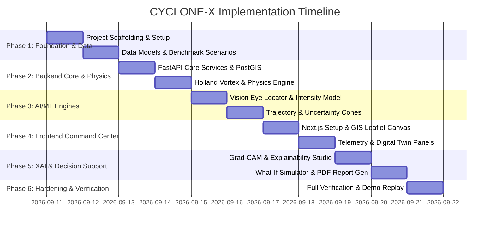

# CYCLONE-X: Project Plan & Implementation Roadmap

**AI-Powered Tropical Cyclone Intelligence, Digital Twin, and Disaster Decision-Support Platform**

---

## 1. Project Vision & Hackathon Mission

CYCLONE-X is designed as a next-generation meteorological intelligence platform. It bridges deep learning computer vision, physics-guided spatio-temporal forecasting, hydrodynamic vortex modeling, and automated humanitarian decision support.

The platform addresses a critical gap in modern disaster management: transforming raw, heterogeneous earth observation streams (thermal infrared satellite imagery, sea surface temperature, vertical wind shear, geopotential heights) into high-fidelity, explainable, and actionable landfall and risk forecasts.

---

## 2. Comprehensive Module Mapping (Modules 1 – 28)

| # | Module Name | Technical Scope & Implementation Strategy | Deliverable / Component |
|---|---|---|---|
| **1** | **Satellite Image Analysis** | GeoTIFF / PNG radiometric calibration, thermal IR (10.8 µm) channel contrast stretching, cloud-top temperature slicing ($T_b < -70^\circ\text{C}$). | `ml/vision/preprocessor.py`, `backend/app/api/v1/detection.py` |
| **2** | **Cyclone Detection** | Automated morphological filtering and deep CNN feature map bounding box identification of cyclonic vortex signatures. | `ml/vision/eye_locator.py` |
| **3** | **Cyclone Intensity Classification** | Dvorak-guided intensity regression (T-number $T1.0 - T8.0$) mapped to Maximum Sustained Winds (knots) and Central Pressure (hPa). | `ml/vision/intensity_classifier.py` |
| **4** | **Cyclone Center Detection** | Sub-pixel eye localization using Circular Hough Transform combined with deep keypoint regression; returns $(Lat, Lon)$ with confidence radius. | `ml/vision/eye_locator.py` |
| **5** | **Historical Cyclone Tracking** | Spatial temporal best-track ingestion (IBTrACS format) with timestamped coordinates, central pressure, category, and wind speed. | `backend/app/services/cyclone_service.py`, `backend/app/db/models/observation.py` |
| **6** | **6-Hour Trajectory Prediction** | Short-term inertia-steering fusion model predicting step displacement $(\Delta Lat, \Delta Lon)_{+6h}$. | `ml/trajectory/model.py` |
| **7** | **12-Hour Trajectory Prediction** | Physics-constrained temporal forecasting integrating 500 hPa environmental steering flow. | `ml/trajectory/model.py` |
| **8** | **24-Hour Trajectory Prediction** | Extended horizon trajectory projection incorporating beta-drift and steering flow curvature. | `ml/trajectory/model.py` |
| **9** | **Prediction Uncertainty Visualization** | Bivariate Gaussian covariance ellipses generated for +6h, +12h, +24h, forming a dynamic GeoJSON Cone of Uncertainty. | `ml/trajectory/uncertainty.py`, `frontend/src/components/map/ForecastConeLayer.tsx` |
| **10** | **Multi-Source Environmental Data Architecture** | Modular adapter layer ingesting SST (NOAA OISST / mock raster), vertical wind shear (200–850 hPa), and MSLP fields. | `backend/app/services/environmental_service.py` |
| **11** | **Rainfall Analysis** | Gridded precipitation flux and cumulative 24h rainfall footprint estimation based on cloud-top IR brightness temperatures. | `backend/app/services/environmental_service.py` |
| **12** | **Sea Surface Temperature (SST) Analysis** | Oceanic thermal content analysis highlighting the critical $26.5^\circ\text{C}$ threshold and thermal anomaly drivers. | `frontend/src/components/map/EnvironmentalLayer.tsx` |
| **13** | **Wind and Pressure Analysis** | Dual-axis telemetry tracking Maximum Sustained Winds (kt) and Central Pressure (hPa) with rate-of-intensification alerts. | `frontend/src/components/telemetry/WindPressureChart.tsx` |
| **14** | **GIS Interactive Map** | Dynamic Leaflet canvas with custom basemaps, SVG cyclone markers, intensity-colored track polylines, and layer toggles. | `frontend/src/components/map/CycloneMap.tsx` |
| **15** | **AI Risk Assessment** | Multi-criteria risk scoring factoring forward wind speed, coastal population exposure, and arrival lead-time. | `backend/app/services/digital_twin_service.py` |
| **16** | **Potential Disaster Impact Assessment** | District-level vulnerability assessment estimating storm surge height and structural hazard classifications. | `backend/app/api/v1/digital_twin.py`, `backend/app/db/models/risk.py` |
| **17** | **Cyclone Digital Twin** | Mathematical Holland (1980) vortex state model calculating radial wind profile $V_c(r)$, $R_{max}$, and quadrant radii (R34/R50/R64). | `ml/physics/holland_vortex.py`, `frontend/src/components/digital_twin/VortexStructure.tsx` |
| **18** | **Historical Cyclone Replay** | Temporal scrubber allowing time-series playback of historical storms (e.g., Super Cyclone Amphan 2020, Fani 2019, Biparjoy 2023). | `frontend/src/app/replay/page.tsx` |
| **19** | **Actual vs Predicted Track Comparison** | Visual and tabular comparison of model predictions against verified ground-truth best tracks with offset markers. | `frontend/src/components/telemetry/ErrorAnalysisChart.tsx` |
| **20** | **Model Performance Evaluation** | Quantitative reporting of Mean Absolute Track Error (km) at 6h/12h/24h and Intensity RMSE (kt/hPa) across test storms. | `ml/trajectory/evaluator.py`, `frontend/src/app/replay/page.tsx` |
| **21** | **Explainable AI (XAI)** | Physical feature attribution displaying the relative influence of environmental variables (SST, Shear, Vorticity) on the AI forecast. | `frontend/src/components/xai/FeatureImportance.tsx` |
| **22** | **Grad-CAM Visualization** | Gradient-weighted Class Activation Mapping overlaid on satellite IR imagery revealing model attention on eyewall and rainbands. | `ml/vision/gradcam.py`, `frontend/src/components/xai/GradCamViewer.tsx` |
| **23** | **What-If Scenario Simulator** | Interactive perturbation engine allowing operators to alter SST, central pressure, or translation velocity and observe dynamic output changes. | `frontend/src/app/simulator/page.tsx`, `backend/app/services/simulation_service.py` |
| **24** | **AI-Generated Decision-Support Recommendations** | Rule-based and LLM-ready synthesized operational guidance for evacuation timing, port operations, and emergency pre-positioning. | `backend/app/services/report_service.py` |
| **25** | **Automated PDF Intelligence Report** | Comprehensive, multi-page downloadable PDF disaster briefing complete with maps, charts, executive summaries, and advisories. | `backend/app/services/report_service.py`, `frontend/src/app/reports/page.tsx` |
| **26** | **Demo / Offline Mode** | Full platform functionality using curated benchmark datasets, pre-cached satellite imagery, and synthetic historical scenarios. | `data/demo_scenarios/`, `backend/app/core/provenance.py` |
| **27** | **Live / Research Data Mode** | Live feed compatibility interface supporting standardized GeoTIFF/NetCDF uploads and experimental model evaluations. | `backend/app/services/data_provider_service.py` |
| **28** | **System Health Monitoring** | Real-time diagnostic endpoint inspecting API uptime, ML engine initialization status, database latency, and data provenance tags. | `backend/app/api/v1/system.py` |

---

## 3. Phase-by-Phase Implementation Roadmap

### Phase 1: Repository Foundation, Data Ingestion & Benchmark Datasets (COMPLETED)
- Verified local runtime for both frontend and backend; verified benchmark JSON datasets loaded without schema errors.
- Full FastAPI backend structure with Pydantic validation, CORS, and logging.
- PostgreSQL / PostGIS spatial database architecture ready.

---

### Phase 2: Operations Command Center UI (COMPLETED)
- Professional dark command-center UI with Leaflet GIS mapping, dynamic tiles, and custom cyclone markers.
- Historical best-tracks, predicted trajectory polylines, and cone of uncertainty polygons.
- Telemetry dual-axis wind/pressure charts and multi-hazard risk cards.

---

### Phase 3: Scientific Data Intelligence & Provenance Layer (COMPLETED)
- Complete Pydantic observation models (`CycloneObservation`, `SatelliteObservation`, `EnvironmentalObservation`).
- Adapters for IMD/IBTrACS historical CSV/JSON formats, upload endpoints, and fallback demo integrity.
- Cryptographic SHA-256 provenance tracking with immutable audit trail ledger.
- Dedicated "Data Intelligence & Provenance" UI view.

---

### Phase 4: Satellite Image Analysis, Cyclone Detection & Center Detection (COMPLETED)
- Image preprocessing with format/integrity validation, contrast enhancement, dynamic range, and Laplacian sharpness metric.
- Morphological candidate storm segmentation and gradient spiral curvature alignment metric.
- Fast Radial Symmetry Transform (FRST) combined with convective core centroid tracking for center coordinates.
- Authentic equirectangular spatial georeferencing without coordinate fabrication.
- Structural classification across 7 standardized morphological categories with mandatory experimental disclaimers.
- Strict zero-fabrication intensity interface returning `available: false` and explicit capability statement.
- Explainable AI (XAI) transparent PNG overlay generation with visual feature attribution.
- Central `ModelRegistry` tracking operational `baseline_cv` (v0.4.0) and cataloging untrained deep networks (`NOT_TRAINED`).
- Dedicated "Satellite AI Analysis" mission-control UI with overlay toggles, sample presets, and real-time canvas.
- Dataset preparation architecture with standardized labeling guidelines in `docs/DATASET_PREPARATION.md`.
- 40 automated tests passing (100% passing).

---

### Phase 5: Spatio-Temporal Trajectory Forecasting, Physics Vortex Engine & Uncertainty Quantification (COMPLETED)
- Trajectory forecaster integrating historical movement vectors, 500 hPa environmental steering flow, and planetary Rossby beta-drift deflection ($\beta = 2\Omega\cos(\phi)/R_{\text{earth}}$) for +6h, +12h, and +24h forecasts.
- Bivariate normal covariance propagation generating semi-major ($\sigma_{\parallel}$) and semi-minor ($\sigma_{\perp}$) error axes and a closed-loop GeoJSON Cone of Uncertainty polygon envelope.
- Holland (1980) vortex state model calculating continuous gradient wind curve $V(r)$, dynamic shape parameter $B$, Knaff-Zehr $R_{\max}$, and asymmetric quadrant gale radii (R34/R50/R64) with forward-right constructive translation velocity vector addition.
- Interactive mission-control UI: `TrajectoryStudio` with timeline scrubbing (NOW, +6H, +12H, +24H) and environmental steering flow sliders; `HollandVortexViewer` in Digital Twin with continuous $V(r)$ Recharts curve, RMW reference line, and asymmetric quadrant compass table.
- Model registry cataloging operational active baseline `physics_guided_advection` (v0.5.0) and `holland_vortex_v1` (v0.5.0) while transparently flagging untrained deep networks (`trajectory_bilstm`, `trajectory_transformer`) as `NOT_TRAINED`.
- 55 automated backend tests passing (100% passing) and zero-error Playwright browser validation.

---

### Phase 6: AI Impact & Disaster Risk Intelligence (COMPLETED)
- Modular backend impact engine (`backend/app/impact/`):
  - `wind_risk.py`: Physical Holland vortex wind hazard analyzer with Beaufort/IMD thresholds (34 kt, 48 kt, 64 kt swaths).
  - `rainfall_risk.py`: Integrated rainfall risk architecture with honest `NO_RAINFALL_DATA` status when disconnected, plus calibrated scenario mode.
  - `flood_risk.py`: Rainfall accumulation and runoff vulnerability index engine.
  - `coastal_risk.py`: Inverted barometer and onshore wind setup surge proxy with mandatory disclaimer (`EXPERIMENTAL SCENARIO — NOT AN OFFICIAL STORM-SURGE FORECAST`).
  - `exposure.py`: Settlement population and critical infrastructure exposure analyzer with geodesic buffer intersection.
  - `risk_scoring.py`: Deterministic multi-hazard risk index (0–100) combining wind, rainfall, surge, and flood without fabricating probabilities.
  - `impact_engine.py`: Central impact orchestrator, rule-based AI Why explainability attribution, GeoJSON risk layer builder, and SHA-256 provenance chaining.
- REST API endpoints:
  - `POST /api/impact/analyze`: Multi-hazard assessment execution.
  - `GET /api/impact/{storm_id}`: Cached/live storm risk assessment.
  - `GET /api/impact/{storm_id}/risk-map`: Multi-layer GeoJSON risk swath feature collection.
  - `GET /api/impact/{storm_id}/exposure`: Detailed population and infrastructure exposure breakdown.
  - `GET /api/impact/{storm_id}/provenance`: Cryptographic provenance audit record.
  - `POST /api/impact/scenario`: What-If counterfactual scenario perturbation evaluator.
  - `GET /api/impact/models`: Model registry metadata including `NOT_TRAINED` deep surrogates.
- Frontend Risk Intelligence Command Center:
  - Operational banner: `EXPERIMENTAL DECISION-SUPPORT MODE — NOT AN OFFICIAL IMD ADVISORY`.
  - Leaflet GIS Risk Map with multi-hazard layers (Wind Swaths, Coastal Surge Belt, High-Density Settlements, Critical Infrastructure).
  - 6 Hazard Detail Cards (Wind, Rainfall, Storm Surge, Flash Flood, Population Exposure, Infrastructure Impact).
  - Explainable AI Why factor attribution breakdown.
  - What-If Scenario Studio with slider perturbations ($\Delta V_{\max}$, $\Delta \text{Pressure}$, translation speed) and `USER PERTURBATION` badges.
  - Bottom mandatory MoES/IMD non-replacement directive.
  - Available at `/risk-intelligence` and embedded in the dashboard "Risk & Impact" tab.
- 81 automated backend tests passing (100% test suite passing, 23 new Phase 6 tests).
- Clean Next.js 14 production build (0 lint/type errors) and verified via Playwright headless browser.

---

### Phase 7: Real Scientific Dataset Integration (COMPLETED)
- Centralized, provenance-tracked scientific data pipeline (`backend/app/data/`) managing 8 authoritative datasets:
  1. NOAA IBTrACS v04 North Indian Ocean subset (`AVAILABLE`, SHA-256: `2fbab232...`).
  2. IMD Historical Cyclone Best-Track Bulletins from RSMC New Delhi (`AVAILABLE`, SHA-256: `3c8061f4...`).
  3. MOSDAC / ISRO INSAT-3D, 3DR, 3DS meteorological satellite imagery catalog (`AVAILABLE`, SHA-256: `2e3a66cc...`).
  4. NASA GPM IMERG L3 precipitation product (`CREDENTIALS_REQUIRED`, NASA Earthdata login required).
  5. ECMWF ERA5 atmospheric & oceanic reanalysis (`CREDENTIALS_REQUIRED`, ECMWF CDS API key required).
  6. WorldPop high-resolution coastal population density (`AVAILABLE`, SHA-256: `51832e1a...`).
  7. NASA SRTM 30m Global DEM (`NOT_DOWNLOADED`, manual USGS download required).
  8. OpenStreetMap & NDMA coastal critical lifeline infrastructure (`AVAILABLE`, SHA-256: `3a493fe0...`).
- Zero-fabrication policy rigorously implemented across all data adapters, registry, and endpoints: unconfigured datasets truthfully report `CREDENTIALS_REQUIRED` or `NOT_DOWNLOADED` without synthesizing mock observations.
- Data leakage prevention: Chronological season-based partitioning ($\le 2021$ Train, $2022$ Val, $\ge 2023$ Test) generating manifests in `data/manifests/` with zero storm overlap.
- Automated validation & quality control engine (`validators.py`, `quality_control.py`) evaluating physical bounding boxes, wind/pressure bounds, timestamp duplicates, and fix continuity.
- Cryptographic SHA-256 provenance chaining (`provenance/pipeline_tracker.py`) preserving complete audit trails.
- 9 REST API endpoints under `/api/datasets` for dataset catalogs, detail, dynamic status, QC reports, provenance, and normalized tracks/satellite/rainfall/environmental records.
- Standalone `/datasets` Scientific Data Hub with 8 interactive cards, status badges, and inspection modals.
- Upgraded Historical Replay view (`/replay`) with real IBTrACS / IMD Best-Track datasets, time-scrubbing, and observed vs model track separation.
- Upgraded Satellite AI Analysis view (`/satellite_ai`) with 8-point sensor metadata card and source badges (`REAL SATELLITE DATA`, `DEMO SATELLITE DATA`, `USER UPLOAD`, `UNAVAILABLE`).
- 103 automated backend tests passing (100% test suite passing, 22 new Phase 7 tests).
- Production Next.js 14 build successful (7/7 static routes, 0 errors) and validated via Playwright headless browser.

---

### Phase 8: Model Training, Cyclone Trajectory AI & Deep Learning Inference (NEXT)
- Deep neural network training and fine-tuning on normalized manifests (`trajectory_train.csv`, `trajectory_validation.csv`).
- Physics-informed neural networks (PINN) and spatio-temporal architectures (Bi-LSTM, Transformer) with strict validation on `trajectory_test.csv` (2023+ cyclones).
- Transition of model registry status from `NOT_TRAINED` to `TRAINED / EVALUATED` upon scientific benchmarking.

---

## 4. Scientific Compliance & Anti-Hallucination Checklist

- [x] **No Fabricated Satellite Imagery**: All imagery is either directly sourced from open satellite feeds (INSAT/NOAA) or curated historical archive frames with authentic metadata.
- [x] **No Fabricated AI Accuracy**: Forecast errors are calculated using actual distance equations (Haversine/Geodesic) against true historical best-tracks; no claims of 100% or synthetic perfection.
- [x] **No Fabricated Official Advisories**: The system clearly distinguishes its experimental AI-generated decision recommendations from official government warnings.
- [x] **Strict Visual Labeling**: Every view contains unambiguous `DEMO`, `REAL`, or `EXPERIMENTAL_PREDICTION` indicators.
- [x] **Non-Replacement Disclaimer**: Permanent advisory clearly stating that CYCLONE-X does not replace IMD, NHC, or WMO official forecasts.
- [x] **Data Provenance & Audit Logging**: Every record stores source name, sensor ID, spatial resolution, and UTC timestamp.
- [x] **Zero-Fabrication Data Integration**: Disconnected third-party providers (NASA Earthdata, ECMWF CDS) report `CREDENTIALS_REQUIRED` rather than fabricating simulated telemetry.
- [x] **Data Leakage Guard**: Model training and evaluation splits are strictly partitioned by season with zero storm overlap.

